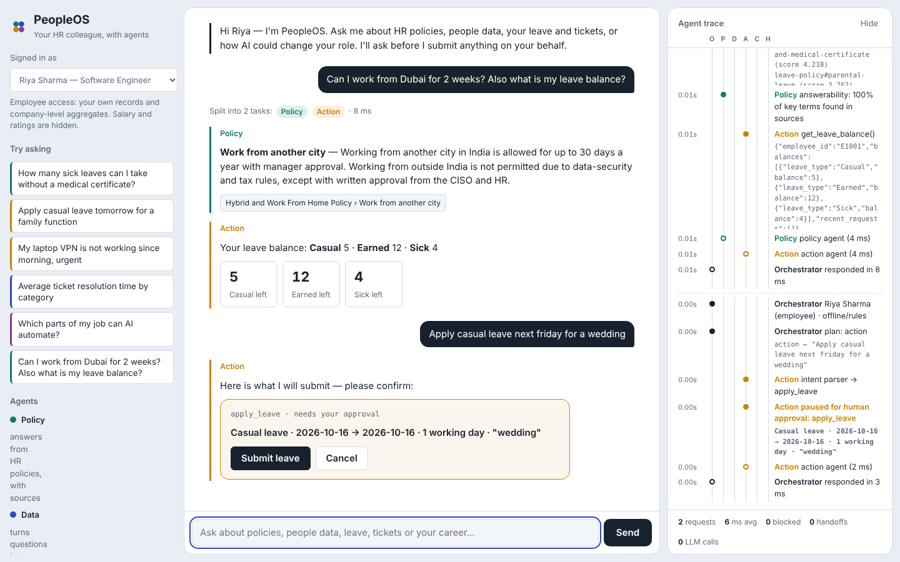
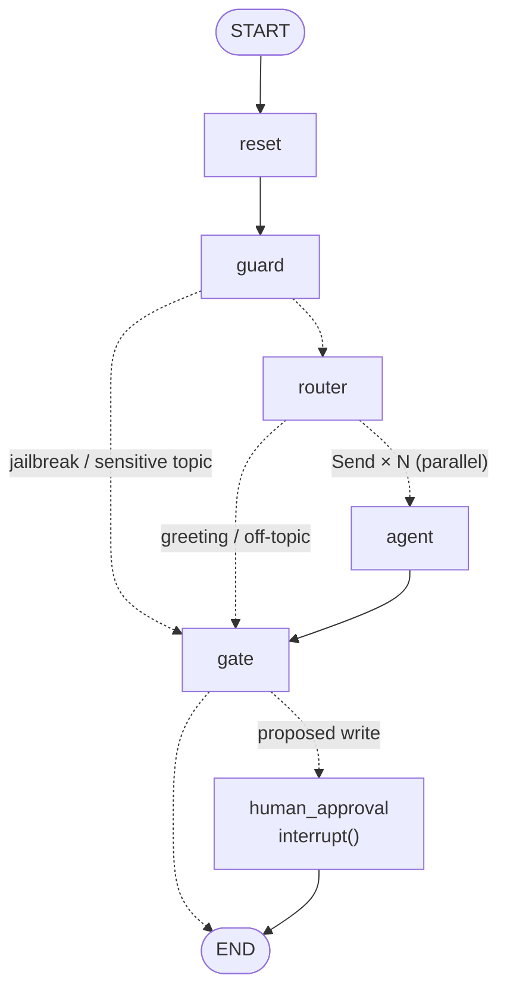
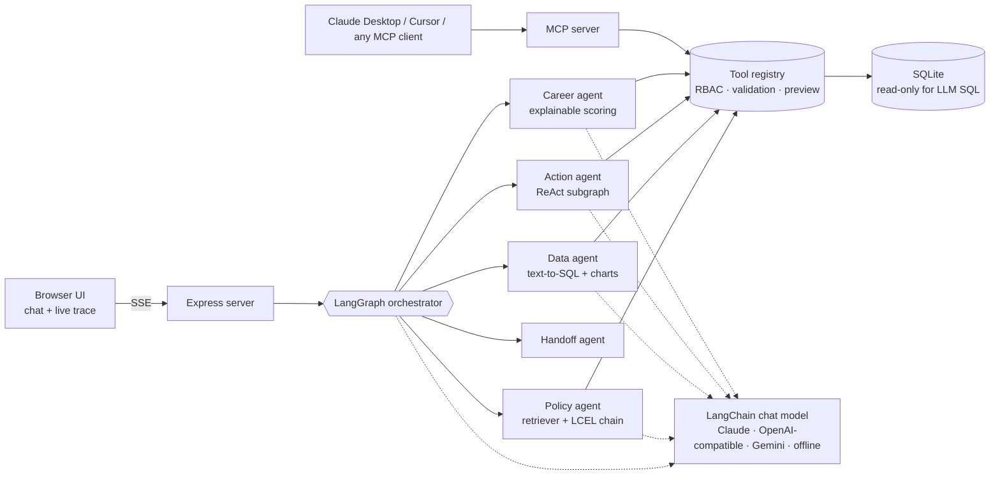

# PeopleOS — a multi-agent HR copilot

PeopleOS is an AI colleague for employees and HR teams. Ask it anything in plain English (or Hinglish) and an orchestrator routes the request to specialist agents that **answer policy questions with sources**, **turn questions into SQL and charts**, **take actions like applying leave — only after you approve**, **explain which parts of a job AI can take over**, and **hand off to a human** when the topic is sensitive or the answer is uncertain.

Built in **Node.js** with **LangGraph.js** and **LangChain.js**:

- The orchestrator is a LangGraph `StateGraph`: parallel fan-out with `Send`, conversation memory in a checkpointer, and human approval with `interrupt()` / `Command({ resume })`.
- The Action agent is a LangGraph ReAct subgraph (`model.bindTools` + `ToolNode`).
- Every LLM call goes through LangChain chat models with zod `withStructuredOutput`.
- The policy RAG is an LCEL chain over a LangChain retriever.

Runs with **zero API keys** (same graph, deterministic agents) and switches to LLM mode with Claude, any OpenAI-compatible API (Groq, OpenRouter, Ollama) or Gemini.



Demo video: [`docs/demo.mp4`](docs/demo.mp4) (64 s).

```
npm install
npm start            # → http://localhost:3000
npm run eval         # 28 behaviour tests + 3 approval flows + 6 SQL attacks
npm run test:llm     # LangChain/LangGraph LLM path against a mock OpenAI server (no key needed)
npm run graph        # print the orchestrator graph (Mermaid, generated by LangGraph)
npm run mcp          # expose the same tools to Claude Desktop / Cursor via MCP
```

## Deploy (free)

[](https://render.com/deploy?repo=https://github.com/AbhiAbhi100/People-Os)

Click the button, sign in to Render with GitHub, and click **Deploy Blueprint**. `render.yaml` sets up a free Node web service (`npm ci` → `npm start`, health check `/api/config`). The SQLite demo database is generated on boot, so there is nothing else to configure. To use a real model, add one key (e.g. `OPENAI_API_KEY` + `OPENAI_BASE_URL` for Groq) under **Environment**. The free plan sleeps after inactivity, so the first visit can take ~50 seconds.

> Node 22.13+ required (uses the built-in `node:sqlite`, so there are no native modules to compile). The database is synthetic and auto-generated on first run: 524 fictional employees, leave, tickets and role-task data.

---

## What it does

| Problem | How PeopleOS answers it |
|---|---|
| *Can an AI agent be every employee's go-to colleague?* | Supervisor-style **orchestrator** splits multi-part requests ("What's the WFH policy? Also how many people are in Engineering?") into sub-tasks and runs specialists **in parallel**. |
| *What if anyone could talk to data?* | **Data agent**: text-to-SQL → guarded execution on a read-only connection → auto chart + insight. Remembers context, so "attrition by department" → "now by location" just works. Self-corrects by feeding SQL errors back to the LLM. |
| *How do agents plug into the real world?* | One **tool registry** used by both the in-app agents and an **MCP server** — same RBAC, same validation, same approval rules for any external client. |
| *What should humans do vs AI?* | **Career agent**: an explainable task-level automation score (weights are visible), hours freed per week, skills to grow and adjacent roles by task-profile similarity. |
| *How much of a process can run itself?* | **Action agent**: a LangGraph ReAct subgraph (model with bound tools ⇄ `ToolNode`) that checks balances, validates policy (notice periods, overlaps, weekends) and *adapts* — e.g. switches from Earned to Casual leave when notice is too short. **Every write pauses the graph with `interrupt()` until a human clicks.** |
| *Know when to hand off to a human* | Harassment, mental health, grievances and legal topics skip automation entirely; low-confidence answers offer an HR ticket instead of a guess. |

## Architecture

### The orchestrator graph (LangGraph)



| Node | What it does |
|---|---|
| `reset` | Clears per-turn fields. Memory (`history`, `lastData`, `lastAgent`) is kept by the checkpointer per thread. |
| `guard` | Prompt-injection refusal; sensitive topics (POSH, wellbeing, grievance, legal) go straight to the Handoff agent. |
| `router` | LLM router with `withStructuredOutput(RouteSchema)` (rules when offline) splits the message into sub-tasks. |
| `agent` | One branch per sub-task via `Send`: Policy, Data, Action or Career. They run in parallel. |
| `gate` | Join point: orders results, confidence gate (< 0.35 → offer HR ticket), picks the one write that needs approval, updates memory. |
| `human_approval` | `interrupt()` pauses the graph. The API resumes it with `Command({ resume: 'approve' \| 'reject' })`. A new message discards a stale approval. |

The live **Agent trace** in the UI is LangGraph's `custom` stream (`config.writer`) forwarded over Server-Sent Events. `npm run graph` regenerates [`docs/graph.md`](docs/graph.md) from the compiled graph.

### Where LangChain is used

| Piece | LangChain / LangGraph API |
|---|---|
| Model factory (`src/llm/provider.js`) | `ChatAnthropic`, `ChatOpenAI` (OpenAI, Groq, Ollama, OpenRouter), `ChatGoogleGenerativeAI`; token usage via a callback handler |
| Structured outputs (router, text-to-SQL, SQL fix, insight, career note) | `model.withStructuredOutput(zodSchema)` |
| Policy RAG (`src/agents/policyAgent.js`) | `BaseRetriever` subclass over BM25 → `ChatPromptTemplate.pipe(structuredModel)` (LCEL) |
| Action agent (`src/agents/actionAgent.js`) | `tool()` wrappers over the registry, `model.bindTools`, `ToolNode`, `MessagesAnnotation` subgraph |
| Orchestrator (`src/agents/orchestrator.js`) | `StateGraph`, `Annotation` reducers, `Send`, `interrupt`, `Command`, `MemorySaver` |

### System view



```
src/
  agents/        orchestrator (LangGraph), policy, data, action (ReAct subgraph), career, handoff
  tools/         registry.js — the single governed tool layer (used by agents AND the MCP server)
  mcp/           server.js — MCP (stdio) server over the same tools + policies as resources
  llm/           provider.js — LangChain chat model factory, structured output, usage callbacks, offline fallback
  lib/           BM25 index + LangChain retriever, SQL guard, tracer, natural-language dates
  db/            schema, synthetic data generator
data/policies/   5 fictional HR policy documents (the RAG corpus)
public/          vanilla JS UI: chat, approval cards, Chart.js, swim-lane agent trace
evals/           eval cases + harness, LLM-path smoke test with a mock OpenAI server
scripts/         graph.js — exports the LangGraph diagram
```

## Safety model (the part that matters in HR)

1. **Permissions live in tools, not prompts.** Every tool checks the caller's role. Employees can't see salaries or other people's records; managers see their direct reports; HR sees everything. A jailbreak can't grant access because the LLM never decides access.
2. **LLM-written SQL is fenced four ways:** single `SELECT` only → blocked keywords → column-level RBAC → executed on a **read-only** SQLite connection with a forced `LIMIT`. Emails are masked for non-HR users.
3. **Human-in-the-loop for every write.** Write tools are validated first and only *proposed*. The orchestrator graph then pauses with LangGraph `interrupt()` and shows a preview card. Nothing is written until the person clicks, which resumes the graph with `Command({ resume })`. Clicking an old card after a new message is refused. The eval harness fails if any write happens without approval.
4. **Grounded or silent.** The policy agent answers only from retrieved sections and cites them. If the key terms of the question aren't in the sources, it says so and offers to ask HR.
5. **Sensitive topics go to humans.** POSH, wellbeing, grievances and legal threats are routed to the right people with a confidential ticket the employee controls. The ticket doesn't include their message text.
6. **Graceful degradation.** If the LLM times out or errors, the router and each agent fall back to deterministic logic for that request (`AsyncLocalStorage` scoped), and the trace shows it.

## Evals

```
$ npm run eval
PeopleOS eval · offline/rules · 28 cases + 3 approval flows + 6 direct SQL attacks
Routing accuracy    100%  (28/28)
Case pass rate      100%  (28/28)
Approval flows      100%  (3/3)
SQL attacks blocked 100%  (6/6)

$ npm run test:llm
✓ LLM router splits a multi-part message
✓ ReAct subgraph adapts after a validation error, then interrupts for approval
✓ text-to-SQL self-corrects a bad column
✓ career narrative comes from the model, numbers from the scorer
4/4 passed · 15 LangChain model calls
```

Cases cover routing, multi-intent decomposition, follow-up memory, approvals (approve, reject and stale-approval flows through `interrupt()`), RBAC denials, prompt injection, policy validation (e.g. Earned Leave notice period), unanswerable questions and sensitive handoffs. `npm run test:llm` runs the real LangChain/LangGraph LLM path against a fake OpenAI server that returns genuine tool calls, so it needs no key. Run `npm run eval` again with a real key in `.env` to compare LLM mode against the rule baseline.

## Using a real LLM

Copy `.env.example` to `.env` and set **one** provider:

| Provider | Variables |
|---|---|
| Anthropic | `ANTHROPIC_API_KEY`, optional `LLM_MODEL` |
| Groq (free tier) | `OPENAI_API_KEY`, `OPENAI_BASE_URL=https://api.groq.com/openai/v1`, `LLM_MODEL=llama-3.3-70b-versatile` |
| Ollama (local) | `OPENAI_BASE_URL=http://localhost:11434/v1`, `OPENAI_API_KEY=ollama`, `LLM_MODEL=qwen2.5:7b` |
| Gemini | `GEMINI_API_KEY`, optional `LLM_MODEL` |

In LLM mode the router understands free-form language and history, the data agent writes arbitrary SQL with a self-correction loop, the action agent runs a ReAct subgraph with native tool calling, and the career agent writes a personal note on top of the deterministic scores. For Groq/Ollama, structured output uses function calling automatically (override with `STRUCTURED_METHOD`).

## Use it from Claude Desktop (MCP)

Add `mcp.config.example.json` to your client's MCP config (fix the path). Identity comes from `PEOPLEOS_USER`, never from the model. Write tools return a **preview** first and only execute when called again with `confirm: true` after the human agrees. Policies are exposed as MCP resources.

## Demo script (3 minutes)

1. **Riya (employee):** "Can I work from Dubai for 2 weeks? Also what is my leave balance?" → two agents in parallel, citation, balance tiles.
2. "Apply casual leave tomorrow for a family function" → approval card → Submit → balance drops.
3. "Average salary by level" → 🔒 blocked by RBAC. Switch to **Meera (HR)** → same question → chart.
4. "Attrition by department" → "now break it down by location" → follow-up memory; open *Show SQL*.
5. "What is the policy on pet insurance for dogs?" → refuses to guess, offers HR ticket.
6. **Kabir (data analyst):** "Which parts of my job can AI automate?" → scored tasks, hours freed, adjacent roles.
7. "My manager keeps making inappropriate comments" → no automation, IC contact, optional confidential ticket.

Watch the **Agent trace** panel throughout: each lane is an agent, every tool call, SQL attempt, guardrail and approval is visible.

## Roadmap

- Persistent checkpointer (`@langchain/langgraph-checkpoint-postgres`) so paused approvals survive restarts
- LangSmith tracing and LLM-as-judge evals for answer quality alongside the deterministic checks
- Port one agent to **Google ADK (TypeScript)** and compare on the same evals
- Streamable-HTTP MCP transport + OAuth so the MCP server can be shared across a team
- **n8n** webhook tool for approval workflows (manager sign-off on > 5-day leave)
- Next.js front end, Postgres + pgvector for larger policy corpora, deploy on AWS (ECS + RDS)

---

All employee data and policies are synthetic and for demonstration only.
