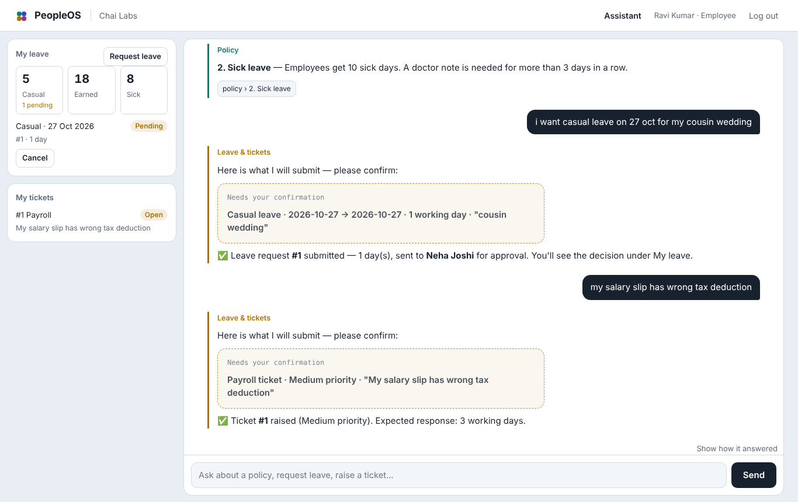
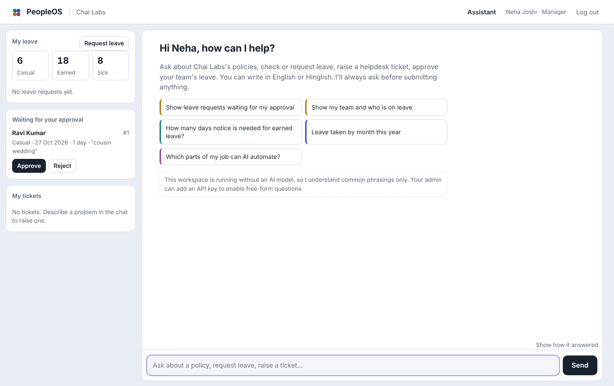
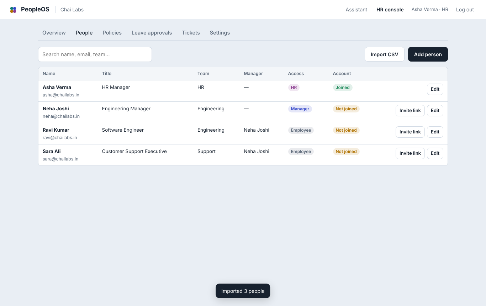
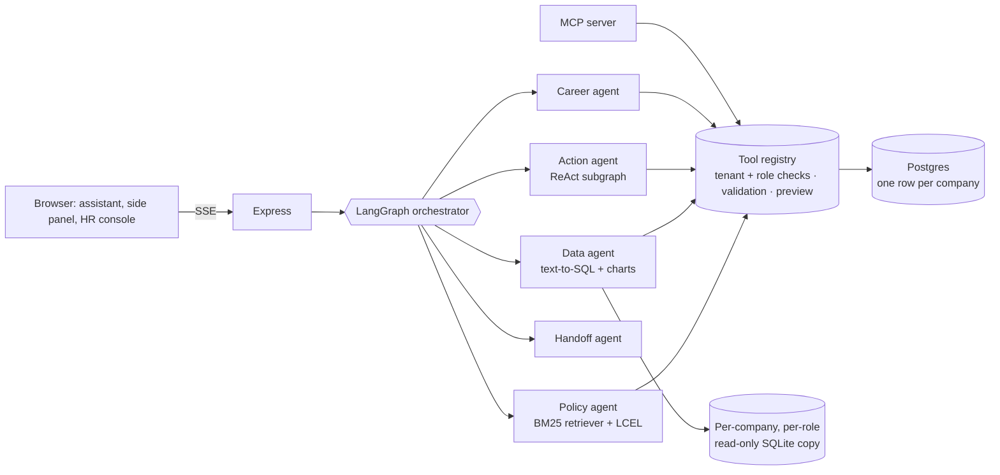
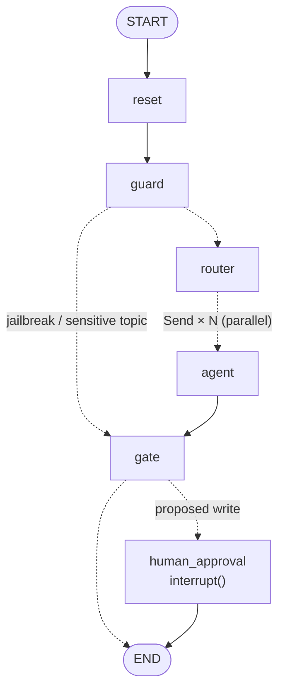

# PeopleOS: an AI HR assistant for small companies

PeopleOS is an HR helpdesk that runs itself. A company signs up and the HR person uploads their policies, imports the team from a CSV and shares invite links. From then on employees just ask in plain English (or Hinglish):

- *"How many sick days do I get?"*: the answer comes from **your** policy PDF, with the section it came from.
- *"Casual leave on 27 Oct for my cousin's wedding"*: it checks the balance and rules, shows what it will submit, and sends it to the **manager** for approval once the employee confirms.
- *"My salary slip has the wrong tax deduction"*: it raises a payroll ticket, and HR replies from the console.
- *"Show my team and who is on leave"* (managers), *"Attrition by department"* (HR): talk-to-data with charts.
- *"My manager keeps making comments about me"*: no automation. It points to the Internal Committee contact the company configured.

Under the hood it is a multi-agent system in **Node.js** built on **LangGraph.js** and **LangChain.js**, with a governed tool layer that is also exposed over **MCP**.



| Manager: approve from the side panel | HR console: people, invites and policies |
|---|---|
|  |  |

**Live:** https://peopleos-5cj1.onrender.com (free plan, so the first visit after a while takes ~50 s to wake up).

---

## How a company uses it

1. **Sign up** at `/signup` with the company name. You become the HR admin.
2. **Policies:** upload PDF (with selectable text), Word, .txt or .md, or paste text. Headings become sections the assistant cites.
3. **People:** add people one by one or import a CSV (`name, email, title, department, manager_email, location, join_date, access`). Managers are linked by email and get the manager role automatically.
4. **Invites:** with email set up, one click emails everyone a link to set their password. Without it, copy each person's link and send it on WhatsApp. Links work once and expire in 14 days; the same button makes a password-reset link for people who already joined.
5. **Settings:** leave types and yearly entitlement, notice for earned leave, auto-approve short requests, contacts for POSH / counselling / ethics, a daily message limit.

| Role | Gets |
|---|---|
| Employee | Assistant, own balances and requests (with cancel), own tickets and HR replies |
| Manager | Everything above plus *Waiting for your approval* for direct reports, team view, team analytics without sensitive columns |
| HR | Everything, plus the HR console: people, policies, all leave approvals, tickets, settings, full analytics |

**Email notifications** (when the server has email set up; each company can switch them off): the manager gets an email when someone requests leave, the employee when it's approved or rejected, HR when a ticket is raised (confidential tickets never include their text), and the employee when HR replies. Anyone can reset their own password from *Forgot password?*.

## Architecture



### The orchestrator graph



- `router` splits multi-part messages (LLM with `withStructuredOutput`, rules without a key); each sub-task runs in parallel via `Send`.
- Every write (apply/cancel/approve leave, raise ticket) is validated, shown as a preview card, and the graph **pauses with `interrupt()`** until the person confirms; the API resumes it with `Command({ resume })`.
- The "Show how it answered" panel is LangGraph's `custom` stream forwarded over SSE.

| Piece | LangChain / LangGraph |
|---|---|
| Models | `ChatGoogleGenerativeAI`, `ChatAnthropic`, `ChatOpenAI` (OpenAI, Groq, Ollama), `.withFallbacks()` for overloaded models |
| Structured output | `withStructuredOutput(zod)` for routing, SQL, insights, policy answers |
| Policy RAG | `BaseRetriever` over a per-company BM25 index → `ChatPromptTemplate.pipe(model)` |
| Action agent | `tool()`, `bindTools`, `ToolNode`, `MessagesAnnotation` subgraph |
| Orchestrator | `StateGraph`, `Send`, `interrupt`, `Command`, `MemorySaver` |

## Safety and isolation

1. **Tenant isolation in every query.** Every table carries `company_id`; tools take the company from the logged-in session, never from the model. The eval suite includes a second company and fails if any of its data leaks across.
2. **Permissions live in tools, not prompts.** Employees see only their own records; managers see direct reports; HR sees everything. A jailbreak can't grant access because the LLM never decides access.
3. **LLM-written SQL never touches the real database.** It runs on an in-memory SQLite copy of *that company's* data, built per role (non-HR copies don't even contain salary, rating or email columns), opened `query_only`, behind a keyword guard and a forced `LIMIT`.
4. **Human-in-the-loop for every write.** Nothing is written until the person clicks; stale approval cards are refused.
5. **Grounded or silent.** Policy answers come only from uploaded documents and cite the section; if the answer isn't there it says so.
6. **Sensitive topics go to people**, using the contacts HR configured (and Tele-MANAS 14416 for wellbeing).
7. **Accounts:** scrypt password hashes, opaque session tokens stored hashed, httpOnly SameSite cookies, rate-limited login/signup/chat, CSP headers, JSON-only state-changing APIs.

## Run locally

```
npm install
npm start            # → http://localhost:3000  (embedded Postgres in data/pglite, no setup)
npm run eval         # 45 cases + 10 flows (approvals, re-org, exits, isolation, emails, reset) + 6 SQL attacks, on a throwaway in-memory DB
npm run test:llm     # real LangChain/LangGraph path against a mock OpenAI server
npm run test:llm -- gemini   # same through ChatGoogleGenerativeAI, incl. the 503 fallback
npm run graph        # print the orchestrator graph (Mermaid)
```

To try emails locally without an email account, start with `MAIL_TRANSPORT=memory npm start` and open `/dev/mail` to see every email the app sent.

Node 22.13+. Without an AI key the agents use deterministic rules (common phrasings work); add a key for free-form questions.

## Deploy (free: Render + Neon)

[](https://render.com/deploy?repo=https://github.com/AbhiAbhi100/People-Os)

1. Create a free Postgres database on [Neon](https://neon.tech) and copy the connection string.
2. Click the button above → **Deploy Blueprint**. Set `DATABASE_URL` to the Neon string and `GEMINI_API_KEY` to a key from [Google AI Studio](https://aistudio.google.com/apikey).
3. Optional: `PUBLIC_URL=https://your-app.onrender.com` so links in emails use the right domain.
4. Optional, for email: make a free [Brevo](https://www.brevo.com) account, verify your sender address (Senders → Add a sender, a Gmail address works), create an API key (SMTP & API → API keys), then set `BREVO_API_KEY` and `MAIL_FROM=Your Company HR <you@gmail.com>`. Render's free plan blocks SMTP, which is why PeopleOS sends through Brevo's HTTP API.

Tables are created on first boot. `DATABASE_URL` is required on Render's free plan: the embedded database used for local runs needs about 500 MB of RAM, more than the free instance has, so the deploy fails without it (the log says so).

| Variable | Purpose |
|---|---|
| `DATABASE_URL` | Postgres connection string (required in production) |
| `GEMINI_API_KEY` / `ANTHROPIC_API_KEY` / `OPENAI_API_KEY` (+ `OPENAI_BASE_URL`) | One AI provider |
| `LLM_MODEL`, `LLM_FALLBACK_MODEL` | Override the model (Gemini default `gemini-3.8-flash`, falls back to `gemini-3.5-flash-lite` on 503/429) |
| `PUBLIC_URL` | Base URL used in invite and notification links |
| `BREVO_API_KEY` + `MAIL_FROM` (or `RESEND_API_KEY`) | Email invites, password resets and notifications |

## Use it from Claude Desktop (MCP)

See `mcp.config.example.json`. Identity comes from `PEOPLEOS_EMAIL` (an active user in the same database), never from the model. Write tools return a preview first and run only when called again with `confirm: true`. Company policies are exposed as MCP resources.

## Project layout

```
src/
  server.js      pages, auth, self-service, HR console and agent APIs
  auth.js        passwords, sessions, invites, role middleware, rate limits
  db/            Postgres / PGlite connection and schema
  services/      company + people, policies (PDF/DOCX parsing, chunking), leave and tickets
  agents/        orchestrator (LangGraph), policy, data, action, career, handoff
  tools/         the single governed tool layer (agents and MCP)
  lib/           SQL sandbox and guard, BM25 + retriever, CSV, dates, role library
  mcp/           MCP stdio server
public/          landing, auth, assistant and HR console (vanilla JS)
evals/           cases, harness, synthetic test companies, LLM mocks
```

## Roadmap

- Postgres checkpointer so paused approvals survive restarts
- Attendance and payslip uploads; Slack / WhatsApp front ends over the same graph
- pgvector embeddings for large policy libraries
